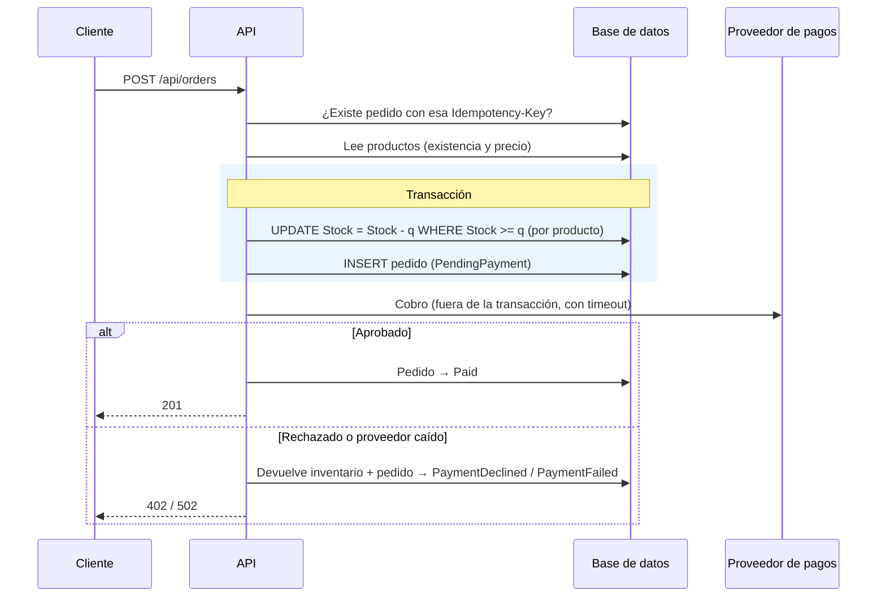

# API de pedidos

Backend mínimo de un sistema de pedidos en .NET 10: crea y consulta pedidos, reserva inventario sin sobreventa y cobra con un proveedor de pagos simulado.

## Cómo ejecutarlo

Requisito: [SDK de .NET 10](https://dotnet.microsoft.com/download/dotnet/10.0). No hace falta instalar base de datos: se usa SQLite y el archivo `orders.db` se crea solo al arrancar, con 4 productos de ejemplo.

```bash
# API en http://localhost:5013  (Swagger en http://localhost:5013/swagger)
dotnet run --project src/Orders.Api

# Pruebas automatizadas
dotnet test
```

Para empezar de cero basta con borrar `src/Orders.Api/orders.db`.

Para probar sin Swagger, `src/Orders.Api/Orders.Api.http` trae todas las peticiones de demostración (pedido exitoso, reintento idempotente, sin inventario, pago rechazado, proveedor caído, validaciones). Se abre con Visual Studio, Rider o la extensión REST Client de VS Code.

## Endpoints

| Método | Ruta | Qué hace |
|---|---|---|
| `POST` | `/api/orders` | Crea un pedido. Cabecera opcional `Idempotency-Key`. |
| `GET` | `/api/orders/{id}` | Consulta un pedido con sus líneas. |
| `GET` | `/api/orders?customerId=&status=&page=&pageSize=` | Lista pedidos (paginado, del más reciente al más antiguo). |
| `GET` | `/api/products` | Catálogo con inventario disponible. |
| `GET` | `/api/products/{id}` | Consulta un producto. |

Ejemplo de creación:

```json
POST /api/orders
Idempotency-Key: 6f1c...

{
  "customerId": "cliente-1",
  "paymentToken": "tok_visa_ok",
  "items": [
    { "productId": 1, "quantity": 2 },
    { "productId": 2, "quantity": 1 }
  ]
}
```

### Respuestas de `POST /api/orders`

| Código | Cuándo |
|---|---|
| `201 Created` | Pedido creado y pagado. Cabecera `Location` con la URL del pedido. |
| `200 OK` | Reintento con una `Idempotency-Key` ya usada: devuelve el pedido original sin crear otro. |
| `400 Bad Request` | Cuerpo inválido (sin líneas, cantidad ≤ 0, cliente vacío, JSON mal formado…). |
| `402 Payment Required` | El proveedor rechazó el pago. El pedido queda registrado como `PaymentDeclined` y el inventario se libera. |
| `409 Conflict` | No hay inventario suficiente. Indica producto, cantidad pedida y disponible. |
| `422 Unprocessable Entity` | Algún producto no existe. |
| `502 Bad Gateway` | El proveedor de pagos falló o no respondió a tiempo. El pedido queda como `PaymentFailed` y el inventario se libera. |

Todos los errores siguen el formato ProblemDetails (RFC 9457, `application/problem+json`). En 402 y 502 la respuesta incluye `orderId` y el pedido completo para que el cliente pueda consultarlo.

### Proveedor de pagos simulado

El resultado depende del `paymentToken`:

| Token | Resultado |
|---|---|
| `tok_declined` | Pago rechazado ("Fondos insuficientes") |
| `tok_gateway_error` | El proveedor responde 503 |
| `tok_timeout` | El proveedor no responde (se corta a los `Payments:TimeoutSeconds`, 5 s por defecto) |
| cualquier otro | Pago aprobado, con referencia `PAY-…` |

La latencia simulada (`Payments:SimulatedLatencyMs`) y el tiempo máximo de espera se configuran en `appsettings.json`.

## Flujo de creación



Estados del pedido: `PendingPayment` → `Paid` | `PaymentDeclined` | `PaymentFailed`.

## Decisiones técnicas

**Prevención de sobreventa con un UPDATE condicional.** El inventario se descuenta con
`UPDATE Products SET Stock = Stock - @q WHERE Id = @id AND Stock >= @q` (`ExecuteUpdateAsync` de EF Core). La base de datos evalúa la condición y el descuento en una sola operación atómica, así que dos solicitudes simultáneas no pueden leer el mismo stock y vender ambas. Si la sentencia no afecta filas, no alcanza el inventario y se responde 409. Se descartó "leer, validar en memoria y guardar" porque tiene una condición de carrera, y la concurrencia optimista (rowversion) porque obliga a reintentar con alta contención sobre productos populares. Como respaldo hay un `CHECK (Stock >= 0)` en la tabla.

**Todo o nada por pedido.** Las reservas de todas las líneas y la inserción del pedido van en una transacción: si una línea no tiene stock, no se descuenta ninguna. Las líneas repetidas del mismo producto se suman antes de validar, y los productos se bloquean siempre en orden de id para evitar interbloqueos en motores con bloqueo por fila (SQL Server, PostgreSQL).

**El pago va fuera de la transacción.** No se mantiene abierta una transacción de base de datos mientras se espera a un servicio externo (bloquearía filas por segundos y agotaría conexiones). Se reserva primero, se cobra después y, si el cobro falla, se compensa devolviendo el inventario. El pedido fallido se conserva para trazabilidad. Desde que se reserva el inventario se ignora la cancelación de la petición HTTP, para que un cliente que cierra la conexión no deje stock reservado indefinidamente.

**Idempotencia.** Con la cabecera `Idempotency-Key`, un reintento (por ejemplo, tras un timeout de red del lado del cliente) devuelve el pedido original en vez de crear otro y cobrar dos veces. Un índice único en la columna resuelve también el caso de dos reintentos simultáneos: el segundo falla al insertar, deshace su reserva y devuelve el pedido del primero. Además, el id del pedido se envía al proveedor como llave de idempotencia del cobro.

**Precio congelado en la línea.** Cada línea guarda nombre y precio unitario del momento de la compra; el total se calcula en el servidor, nunca se recibe del cliente.

**SQLite + EF Core.** Permite ejecutar el proyecto sin instalar nada. El código no depende de SQLite: cambiar a SQL Server o PostgreSQL es cambiar el proveedor de EF Core y la cadena de conexión. El esquema se crea con `EnsureCreated()` por simplicidad; en producción se usarían migraciones.

**Pasarela de pagos detrás de una interfaz.** `IPaymentGateway` aísla el proveedor. `FakePaymentGateway` lo simula de forma determinista según el token, lo que permite probar todos los caminos sin mocks. Una integración real sería otra implementación con `HttpClient` y políticas de reintento (Polly / `Microsoft.Extensions.Http.Resilience`).

**Un solo proyecto con carpetas por responsabilidad** (`Domain`, `Data`, `Services`, `Payments`, `Contracts`, `Controllers`, `Infrastructure`). Para el alcance pedido, separar en varias capas/proyectos añadía ceremonia sin beneficio; la lógica de negocio está concentrada en `OrderService`.

**Errores.** Las validaciones de entrada usan DataAnnotations (400 automático de `[ApiController]`); las reglas de negocio lanzan excepciones específicas que `DomainExceptionHandler` traduce a ProblemDetails (409, 422); cualquier otro error se registra en el log y devuelve un 500 genérico sin detalles internos.

## Pruebas

`tests/Orders.Tests` contiene pruebas de integración (xUnit + `WebApplicationFactory`) que levantan la API completa en memoria contra un archivo SQLite temporal, por lo que prueban también el SQL real del descuento de inventario.

| Prueba | Qué garantiza |
|---|---|
| `Concurrent_orders_never_oversell` | 30 compras simultáneas de un producto con 5 unidades: exactamente 5 éxitos, 25 respuestas 409 y stock final 0. |
| `Order_is_all_or_nothing_when_one_line_lacks_stock` | Si una línea no tiene stock, no se descuenta ninguna y no se crea el pedido. |
| `Repeated_lines_of_same_product_are_merged_before_checking_stock` | Dos líneas de 2 unidades no pasan con stock 3. |
| `Create_with_enough_stock_returns_201_charges_and_decrements_stock` | Camino feliz: 201, total correcto, referencia de pago, `Location`, stock descontado. |
| `Create_with_more_than_available_returns_409_and_keeps_stock` | 409 con el disponible y el stock intacto. |
| `Declined_payment_returns_402_and_releases_stock` | Pago rechazado: 402, pedido `PaymentDeclined`, inventario devuelto. |
| `Payment_gateway_failure_returns_502_and_releases_stock` | Proveedor con error y con timeout: 502, pedido `PaymentFailed`, inventario devuelto. |
| `Same_idempotency_key_creates_a_single_order` | El reintento devuelve 200 con el mismo pedido y no descuenta dos veces. |
| `Concurrent_requests_with_same_idempotency_key_create_a_single_order` | 5 reintentos simultáneos con la misma llave crean un solo pedido. |
| `Invalid_payload_returns_400` | Lista vacía, cantidades ≤ 0, cliente vacío, token faltante, JSON con tipos incorrectos. |
| `Unknown_product_returns_422`, `Get_unknown_order_returns_404` | Códigos de error. |
| `Get_order_returns_items_with_price_snapshot`, `List_filters_by_customer_and_status` | Consultas. |

## Fuera del alcance (siguientes pasos)

- **Pagos con resultado incierto.** Ante un timeout el cobro pudo haberse hecho en el proveedor. Aquí se marca `PaymentFailed` y se libera el stock; en producción el pedido quedaría en `PendingPayment` y un proceso de conciliación (o el webhook del proveedor) definiría el estado final.
- **Reservas huérfanas.** Si el proceso se cae entre la reserva y el pago, el pedido queda en `PendingPayment`. Un job periódico liberaría las reservas vencidas.
- **Idempotencia más estricta:** guardar un hash del cuerpo y responder 422 si se reutiliza la llave con otro contenido; asociar la llave al cliente autenticado.
- Autenticación/autorización, migraciones de EF Core, cancelación de pedidos, outbox para publicar eventos (`OrderPaid`) y observabilidad (OpenTelemetry).
